# TurnSignalMirrors — The Bus

[English](README.md) | **繁體中文**

**The Bus** 的 UE4SS Lua 模組：打方向燈時，才顯示那一側的 HUD 後視鏡視窗（就是在 Tab／HUD 編輯模式裡加上去的那幾個）。

## 需求

- The Bus（測試版本 1.2.0.100996，Unreal Engine 5.6）
- [UE4SS](https://github.com/UE4SS-RE/RE-UE4SS/releases/tag/experimental-latest) **experimental** 版（正式版 v3.0.1 不支援 UE 5.6）

## 安裝

1. 把 UE4SS experimental 的 zip 解壓到 `The Bus\TheBus\Binaries\Win64\`，裡面會多出 `dwmapi.dll` 和 `ue4ss\` 資料夾。
2. 把本 repo 的 `TurnSignalMirrors` 資料夾複製到 `Win64\ue4ss\Mods\`。
3. 打開 `ue4ss\Mods\mods.txt`，在 `Keybinds : 1` 上面加一行 `TurnSignalMirrors : 1`。
4. 進遊戲上車，按 Tab 把左、右兩個 HUD 後視鏡加上去。

**移除：** 刪掉 `ue4ss\Mods\TurnSignalMirrors`。如果連 UE4SS 也不要了，再刪掉 `dwmapi.dll` 和 `ue4ss\` 資料夾。

## 行為

| 狀態 | 左後視鏡 | 右後視鏡（含輪邊鏡） |
|---|---|---|
| 方向燈關閉 | 隱藏 | 隱藏 |
| 打左燈 | 顯示 | 隱藏 |
| 打右燈 | 隱藏 | 顯示 |
| Tab／HUD 編輯模式 | 顯示 | 顯示 |

方向燈關掉後，後視鏡會多停留 `HoldSeconds` 秒才收起來。

## 熱鍵

- `Ctrl+F11`：開關這個模組（關閉時後視鏡恢復常駐顯示）
- `Ctrl+F12`：把目前狀態寫進 `ue4ss\UE4SS.log`

## 設定

在 `Scripts/main.lua` 最上面：

| 參數 | 預設值 | 說明 |
|---|---|---|
| `HoldSeconds` | `1.5` | 方向燈關掉後，後視鏡多留幾秒才收起來 |
| `ShowBothOnHazard` | `false` | 開雙閃時兩邊都顯示 |
| `IncludeRightWheel` | `true` | 右側輪邊鏡跟著右燈一起顯示 |
| `PollMs` | `100` | 輪詢間隔（毫秒） |

## 已知限制

- 只在單機模式、Berlin 地圖、Scania Citywide 上實測過。其他車只要後視鏡元件名稱是 `Mirror_Left_*`／`Mirror_Right_*`，應該都能用。
- 沒有在多人連線模式下測試過。
- 後視鏡只是設成透明，遊戲還是會照常渲染，所以 FPS 不會因此變高。
- 依賴遊戲內部的類別名稱（`UMG_MirrorHUD_C`、`BP_IndicatorModule_C`），遊戲更新後可能會失效。
- 在 Steam 上「驗證遊戲檔案完整性」會把 UE4SS 清掉，驗證完要重新安裝。

## 授權

[MIT](LICENSE)
